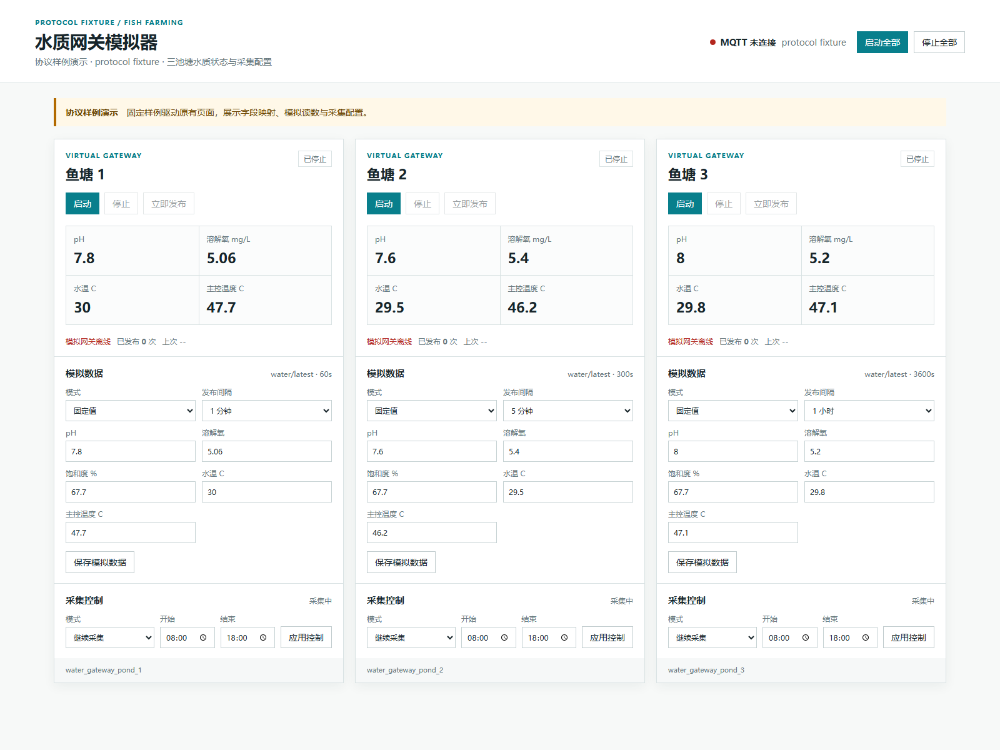
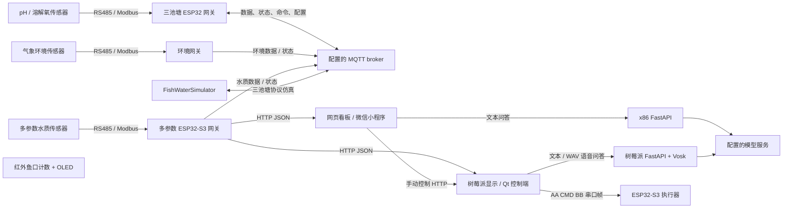

# 种鱼数智管理平台

**Smart Fish Farming Platform · 嵌入式采集、现场控制、多端看板与智能问答**

面向鱼塘养殖管理的软硬件协同工程。传感器经 RS485 / Modbus-RTU 接入 ESP32 网关，水质与环境数据通过 HTTP、MQTT 进入现场显示和多端界面；树莓派 Qt 控制端通过串口帧驱动执行模块，Python 服务承接文本与语音问答。配套三池塘水质仿真器与离线回归测试，可从协议、状态转换和接口处理三个层面阅读与验证工程。

本仓库按原有模块组织源码，保留固件、Python、Qt、网页与小程序之间可追踪的接口关系。连接配置使用空值、回环地址或文档示例地址，适合代码审阅、技术交流和独立联调。

[架构与协议](docs/ARCHITECTURE.md) · [模块与目录](docs/MODULES.md) · [构建与测试](docs/BUILD_AND_TEST.md) · [配置说明](docs/CONFIGURATION.md) · [验证记录](docs/VERIFICATION.md)

## 界面预览



三池塘仿真器原有界面的协议样例演示（protocol fixture），展示水质指标、发布间隔、模拟输入和采集时段设置。

## 工程看点

| 技术方向 | 源码中的实现 | 建议阅读入口 |
| --- | --- | --- |
| 嵌入式通信 | Modbus CRC16、应答校验、传感器间隔、重试与在线状态管理 | `esp32s3_water_gateway_pond1/src/main.cpp` |
| 采集与上报调度 | 将 2 秒采集周期与可配置 MQTT 上报周期分离，支持运行、暂停及跨午夜时段 | `esp32s3_water_gateway_pond1/include/pond_config.h`、`FishWaterSimulator/simulator_core.py` |
| 多池塘设备组织 | 三套独立池塘配置、池塘与网关标识、数据与控制状态主题 | `esp32s3_water_gateway_pond1/` 至 `pond3/` |
| 多参数水质接入 | COD、pH/EC、氨氮、亚硝酸根、硝酸根采集及统一 HTTP 数据输出 | `new-esp32s3_water_gateway/src/main.cpp` |
| 现场人机交互 | Qt Widgets、触屏输入、串口控制、水质轮询、主机状态与问答界面 | `smpqt_control/test/widget.cpp` |
| 多端数据表达 | 网页图表、小程序快照缓存与趋势、水质报告、摄像头入口和手动控制入口 | `web_dashboard/`、`wx_mini_program/miniprogram/` |
| 智能问答 | FastAPI 文本接口、上下文整理、模型服务桥接、Vosk WAV 语音识别 | `x86api_text_ai/after_api.py`、`smpapi_voice_assistant/smp_api.py` |
| 可验证性 | 纯协议状态逻辑、Flask 测试客户端、假 MQTT 客户端、固件源码契约回归 | `FishWaterSimulator/tests/`、`tests/` |

## 系统组成



图中箭头对应源码中的接口。三池塘 MQTT 仿真与多参数 HTTP 看板各有自己的数据结构，具体字段与适配关系见[架构文档](docs/ARCHITECTURE.md)。

## 源码目录

```text
.
|-- esp32s3_water_gateway_pond1/       # 一号池塘 pH / 溶解氧网关
|-- esp32s3_water_gateway_pond2/       # 二号池塘
|-- esp32s3_water_gateway_pond3/       # 三号池塘
|-- esp32_wroom32ue_water_gateway/    # 经典 ESP32，多池塘构建环境
|-- esp32s3_environment_gateway/     # 风、雨、气压、温湿度、光照
|-- new-esp32s3_water_gateway/        # 多参数水质网关
|-- new-esp32s3_actuator/             # 串口控制的双路电机 / 照明
|-- new-esp32s3_fish_counter/         # 红外计数、去抖、OLED、NTP
|-- FishWaterSimulator/              # Flask 面板、MQTT 仿真、原有测试
|-- raspi_water_display/             # 标准库 HTTP 显示与网关代理
|-- smpqt_control/test/              # Qt 应用源码；test 是原工程目录名
|-- smpapi_voice_assistant/          # 树莓派文本 / 语音问答 API
|-- x86api_text_ai/                  # 网页 / 小程序文本问答 API
|-- web_dashboard/                  # 单文件网页看板
|-- wx_mini_program/                 # 微信小程序
|-- tests/                          # 原有固件源码回归测试
|-- tools/                          # 公开包检查与离线验证入口
`-- docs/                           # 架构、模块、配置、构建、验证与来源清单
```

## 模块功能

**传感与网关。** 三池塘版本读取 pH 与溶解氧，发布水温、溶氧浓度、饱和度、芯片温度及传感器在线信息；支持 MQTT 采集模式和发布间隔配置。WROOM-32UE 版本使用 LED 显示运行与错误状态，并通过三个 PlatformIO 环境选择池塘。多参数版本对五个传感器地址组织轮询，向前端输出水温、pH、电导率、TDS、盐度及含氮指标。环境网关独立采集风雨、气压、温湿度与光照。

**现场控制与计数。** Qt 控制端维护水质请求、触屏交互、主机状态、录音与问答流程，并向执行器发送三字节串口帧。执行器解析前进、后退、停止、开灯和关灯命令。鱼口计数模块通过红外输入、去抖、重新布防与最小计数间隔形成计数状态机，在 OLED 显示计数与时间。

**多端展示。** 网页看板按配置的网关地址拉取数据，展示指标、趋势与图表，并调用文本问答接口。小程序按页面分为账号、水质、分析、摄像头和说明，使用本地存储保存配置、快照与有限历史，水质工具模块统一整理指标和报告。树莓派轻量显示使用 Python 标准库提供静态页面及网关数据代理。

**问答服务。** x86 服务接收问题、历史与水质上下文；树莓派服务增加 WAV 上传和 Vosk 识别，再将文本送入配置的模型接口，返回回答及播报文本。实际设备动作走显式控制接口，问答逻辑保持建议型交互。

**协议仿真。** `FishWaterSimulator` 提供三池塘状态、固定值/随机扰动/零值/离线模式、采集时段与上报配置。其纯逻辑模块不依赖硬件，应用测试使用假 MQTT 客户端验证订阅、发布和命令处理。

## 快速验证

Python 测试依赖就绪后，从仓库根目录运行：

```powershell
python -B tools/run_offline_checks.py
```

这条命令解析 Python、JavaScript、JSON 与 Qt XML，校验来源清单和配置示例，并统一运行原有固件回归测试与仿真器测试。

需要准备独立环境时：

```powershell
python -m venv .venv
.\.venv\Scripts\python.exe -m pip install -r requirements-test.txt
.\.venv\Scripts\python.exe -B tools/run_offline_checks.py
```

固件、Qt、问答服务与小程序的构建入口见[构建与测试](docs/BUILD_AND_TEST.md)，实际检查结果见[验证记录](docs/VERIFICATION.md)。

## 配置方式

| 模块 | 公开示例 | 本地使用 |
| --- | --- | --- |
| ESP32 固件 | 头文件或 `main.cpp` 内的空连接常量 | 按[配置说明](docs/CONFIGURATION.md)设置自己的设备环境 |
| 仿真器 | `FishWaterSimulator/simulator_config.example.json` | 复制为同目录 `simulator_config.json`，也可用 `FISH_MQTT_*` 环境变量 |
| 树莓派显示 | `raspi_water_display/config.example.json` | 复制为同目录 `config.json` |
| 树莓派问答 | `smpapi_voice_assistant/.env.example` | 复制为同目录 `.env` 后填写自己的配置 |
| x86 问答 | `x86api_text_ai/.env.example` | 复制为同目录 `.env` 后填写自己的配置 |
| 微信小程序 | `wx_mini_program/project.config.example.json` | 复制为 `project.config.json`，在开发者工具配置自己的项目 |
| 网页与 Qt | 源码中的示例地址、界面配置入口 | 使用与所选采集链路对应的 HTTP 地址 |

`192.0.2.10` 和 `*.example.invalid` 仅用于示例；空固件连接常量需要在本地填写。本地 `.env`、运行配置、构建输出和缓存已纳入忽略规则。

## 阅读建议

- **工程概览：** 先看本页模块表，再看[模块指南](docs/MODULES.md)中的职责、技术栈与入口。
- **嵌入式方向：** 从 `pond_config.h`、传感器轮询、MQTT 控制与发布调度进入，再对照 `tests/` 的契约检查。
- **上位机与全栈方向：** 从 Qt 的 HTTP/串口边界、小程序 `water-quality.js` 和两套 FastAPI 路由进入。
- **复现与维护：** 先运行离线检查，再按[构建文档](docs/BUILD_AND_TEST.md)选择模块和环境。

## 来源与依赖

本包由现有工程中选择的源文件整理而成，公开配置已脱敏，来源与文件摘要记录在 [SOURCE_MANIFEST.json](docs/SOURCE_MANIFEST.json)。第三方框架、库、CDN、模型与服务名称及原有源码注释按来源保留，说明见[第三方依赖与资源](docs/THIRD_PARTY_NOTICES.md)。

