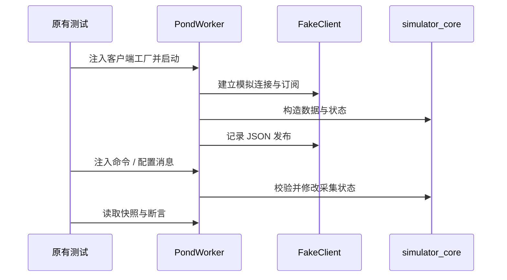

# 架构与协议

## 1. 系统分层

平台围绕采集、传输、展示、控制和问答组织模块。传感器通信与设备动作位于 ESP32 和树莓派侧，网页与小程序通过已配置的 HTTP 地址访问数据与业务接口，MQTT 为网关提供发布、状态与配置通道。

| 层 | 模块 | 主要责任 |
| --- | --- | --- |
| 采集层 | 三池塘网关、WROOM 网关、多参数网关、环境网关、鱼口计数 | 读取传感器、校验帧、维护在线信息、形成读数或计数 |
| 传输层 | 网关 HTTP、MQTT 客户端、Qt 串口与远程控制 HTTP | 传递 JSON 数据、配置及控制帧 |
| 交互层 | Qt、树莓派显示、网页、小程序 | 展示快照、趋势与状态，承接用户配置、问答与显式操作 |
| 问答层 | x86 文本 API、树莓派语音 API | 整理上下文、识别音频、调用模型、返回回答 |
| 验证层 | 仿真器、固件源码测试、离线检查工具 | 在隔离环境核验协议、状态逻辑与源码包一致性 |

各层的对应实现可从[模块指南](MODULES.md)跳转。

## 2. 两类水质采集链路

### 三池塘 pH / 溶解氧链路

`esp32s3_water_gateway_pond1/2/3` 分别维护池塘配置，传感器使用同一 RS485 总线上的不同地址：pH 为 `1`，溶解氧为 `2`。配置包含 UART 波特率、RS485 引脚、OLED、应答超时、传感器访问间隔、在线判定与网络重连间隔。

`esp32_wroom32ue_water_gateway` 采用经典 ESP32，PlatformIO 的 `pond1`、`pond2`、`pond3` 环境通过 `POND_NUMBER` 选择配置，运行与错误状态由 GPIO25/GPIO26 指示。

核心调度将传感器采集和 MQTT 上报分开：

- 自动采集基准为 `2000 ms`。
- 同一请求间隔为 `80 ms`，不同传感器之间增加 `500 ms` 间隔。
- 默认 MQTT 发布间隔为 `3600 s`。
- 支持的发布间隔为 `2 / 60 / 300 / 1800 / 3600 / 21600 / 86400 s`。
- `run`、`pause`、`schedule` 控制采集模式，定时窗口支持跨午夜。

各项调度参数集中在配置头文件，便于按传感器与网络环境调整。

### 多参数 HTTP 链路

`new-esp32s3_water_gateway` 轮询五个地址：

| 地址 | 传感器组织 | 主要指标 |
| --- | --- | --- |
| 1 | COD | COD、水温 |
| 2 | pH / EC | pH、电导率、水温、TDS、盐度 |
| 3 | 氨氮电极 | 浓度、电极电位、温度与状态 |
| 4 | 亚硝酸根电极 | 浓度、电极电位、温度与状态 |
| 5 | 硝酸根电极 | 浓度、电极电位、温度与状态 |

网关的 `/api/water/latest` 为网页、Qt、小程序及轻量显示提供数据入口，`/api/water/health` 提供网关健康信息。前端常用响应包含 `ok`、`data.connected`、`data.updateTime`、`data.gateway` 与 `data.metrics`，具体字段由网关 JSON 构造代码和前端归一化函数共同定义。

三池塘 MQTT 数据以 pH 和溶解氧为核心，多参数 HTTP 数据以九项前端指标为核心。选择消费端时应按字段结构对接；`FishWaterSimulator` 对齐三池塘 MQTT 契约。

## 3. MQTT 主题

以一号池塘为例，`pond_2` 与 `pond_3` 按相同结构替换：

| 主题 | 方向 | 用途 |
| --- | --- | --- |
| `fish/pond/pond_1/water/latest` | 网关 → broker | 最新水质与采集状态 |
| `fish/pond/pond_1/water/status` | 网关 → broker | 在线及连接信息 |
| `fish/pond/pond_1/water/cmd` | broker → 网关 | 运行、暂停、定时采集命令 |
| `fish/pond/pond_1/water/control/status` | 网关 → broker | 当前采集模式、时段和发布间隔 |
| `fish/pond/pond_1/water/config` | broker → 网关 | 发布间隔配置 |

多参数网关的主题为 `fish/water/latest` 与 `fish/water/status`。环境网关以 `environment_config.h` 中的主题前缀和运行时设备标识生成主题。

### 最新水质载荷

以下为协议示例，数值与时间用于说明字段：

```json
{
  "pondId": "pond_1",
  "gatewayId": "water_gateway_pond_1",
  "sampledAt": "2026-10-16 10:00:00",
  "timeSynced": true,
  "ph": 7.8,
  "dissolvedOxygen": 5.06,
  "doMgL": 5.06,
  "doSaturation": 67.7,
  "waterTemp": 30.0,
  "chipTempC": 47.7,
  "phOnline": true,
  "doOnline": true,
  "onlineSensors": 2,
  "pollCycles": 1
}
```

`doMgL` 表示溶氧浓度，`doSaturation` 表示饱和度，`dissolvedOxygen` 是载荷保留的浓度字段。`chipTempC` 为芯片温度，应与水温分别展示。读取传感器状态与时间字段可以区分读数、采集时间及在线状态。

### 控制与配置载荷

```json
{"mode": "pause"}
```

```json
{"mode": "run"}
```

```json
{"mode": "schedule", "scheduleStart": "22:00", "scheduleEnd": "06:00"}
```

```json
{"publishIntervalSeconds": 60}
```

这些 JSON 是协议说明，不包含发布命令。控制后应读取 `control/status` 中的 `mode`、`collecting`、`timeSynced`、`timeText` 和 `publishIntervalSeconds`，核对网关实际状态。

## 4. 环境监测链路

环境网关以 Modbus 功能码 `0x03` 读取风、雨、气压及空气综合传感器。JSON 构造代码输出：

- 风速、风力级、风向角与风向码。
- 当日、瞬时、昨日、累计与小时雨量，以及 24 小时极值等寄存器数据。
- 气压、空气温度、相对湿度和照度。
- 各组传感器的在线标志、在线数量、轮询次数和发布状态。

不同传感器读数分别维护运行状态。无效读数通过可空字段表达，界面或消费端应同时判断数值与对应在线信息。

## 5. 现场控制链路

Qt 应用通过 `QSerialPort` 连接执行器，串口波特率为 `115200`，三字节帧格式为：

```text
0xAA  CMD  0xBB
```

| CMD | 语义 |
| --- | --- |
| `0x01` | 前进 |
| `0x02` | 后退 |
| `0x03` | 停止 |
| `0x04` | 开灯 |
| `0x05` | 关灯 |

执行器串口状态机按帧头、命令与帧尾推进，再修改运动或照明状态。双路脉冲输出和方向信号位于执行器固件，Qt 只负责发送命令。

小程序的控制页通过 `http://<host>:8090/control?cmd=...` 请求 Qt 的远程控制入口，Qt 使用 `QTcpServer` 解析 HTTP 请求，再映射到现场控制。摄像头页构造独立的 MJPG Streamer URL，常用配置端口为 `8080`；图像服务与控制服务各有入口。

Qt 登录页按非空输入进入界面；小程序账号、注册与会话保存在 `wx` 本地存储。

## 6. 问答与语音

| 服务 | 路由 | 输入 / 输出职责 |
| --- | --- | --- |
| x86 文本 | `POST /api/ai/chat` | 问题、历史与水质上下文 → 回答 |
| x86 健康 | `GET /health`、`GET /api/health` | 服务、模型配置与时间 |
| 树莓派文本 | `POST /api/smp/chat`、`POST /api/smp/assistant/chat` | 问题、会话、系统上下文与用户称呼 → 回答及播报文本 |
| 树莓派语音 | `POST /api/smp/voice/chat` | WAV 上传 → Vosk 识别 → 文本问答 |
| 树莓派健康与能力 | `GET /api/smp/health`、`GET /api/smp/capabilities` | 服务与语音模型准备状态 |

WAV 解析检查未压缩、单声道、16-bit PCM；Qt 录音流程按 16 kHz 使用。回答由配置的模型服务生成，问答代码整理问题长度、历史条数与上下文，处理网络和上游响应异常。Vosk 模型路径通过环境变量配置，Qt 侧包含播放与 `edge-tts` 调用流程。

模型服务地址、模型标识与密钥通过本地配置提供。保留的默认模型字符串属于原始代码配置，实际联调时应以所选服务支持的标识为准。

## 7. 仿真与测试边界

`simulator_core.py` 只处理状态和协议，不打开网络。`app.py` 将每个池塘封装为独立 `PondWorker`，允许注入 MQTT 客户端；原有测试通过 `FakeClient` 记录订阅与发布，Flask 测试客户端处理本地请求。



固件根目录测试检查源码中的关键配置、主题订阅、调度与芯片温度字段，属于源码契约检查。测试类型、实际执行命令与结果见[验证记录](VERIFICATION.md)。
